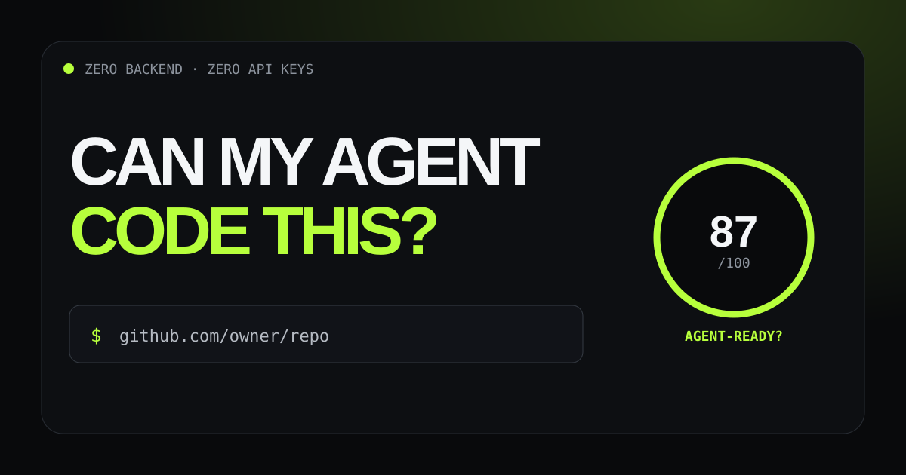

# Can My Agent Code This?



**Paste a public GitHub repo → get an instant, ecosystem-aware coding-agent readiness audit.**

[**→ Try the live scanner**](https://pixelsrgb.github.io/can-my-agent-code-this/)

[](#)
[](#)
[](LICENSE)

Coding agents are getting better fast. Repositories are not always keeping up.

**Can My Agent Code This?** audits the repo-level signals that help AI coding agents understand, change, and verify a codebase safely: instructions, docs, tests, CI, deterministic setup and review guardrails.

## What's new in v2

The scanner is now **ecosystem-aware** instead of assuming every repo behaves like a Node project.

It can infer native verification signals for stacks including:
- Node.js / JavaScript
- Rust / Cargo
- Go
- Python
- Gradle and Maven
- Bazel
- Ruby
- PHP / Composer
- Elixir / Mix
- CMake

It also:
- evaluates whether agent instructions include verification and guardrails;
- gives mature repos limited fallback credit when they have strong contributor docs but no agent-specific file;
- stops dumping huge raw test-path counts;
- separates score from confidence when GitHub truncates very large repository trees;
- no longer requires irrelevant signals such as `.env.example` for every project.

## What it checks

The score is 100 points across six explainable categories:

1. Agent instructions — 20
2. Documentation — 15
3. Tests & verification — 20
4. CI automation — 15
5. Project clarity — 15
6. Safe change workflow — 15

See [`docs/scoring.md`](docs/scoring.md) for the full rubric.

## Run locally

The app itself has no runtime dependencies.

```bash
npm ci
python -m http.server 8080
```

Then open `http://localhost:8080`.

## Verify changes

```bash
npm run check
```

That runs syntax checks and the Node built-in test suite.

## Deploy to GitHub Pages

This repo includes an Actions workflow for Pages. Set **Settings → Pages → Source** to **GitHub Actions** once, then pushes to `main` deploy automatically.

## Privacy and safety

- No analytics
- No cookies
- No account
- No backend
- No required GitHub token
- Repository code is **never executed**
- The browser only reads public GitHub metadata, repository paths, and small text config/docs files

GitHub's unauthenticated API rate limits still apply.

## Important limitation

The score is intentionally heuristic. It does **not** mean “an agent has an X% chance of succeeding,” and it does not measure overall code quality. It measures visible repository structure that tends to reduce ambiguity and improve verification.

## Contributing

Issues and PRs are welcome, especially concrete examples where the rubric mis-scores a real repository. Please include the repo, the observed score, and the signal you think is over- or under-weighted.

## License

MIT
